

  <a href="https://sljrobin.org">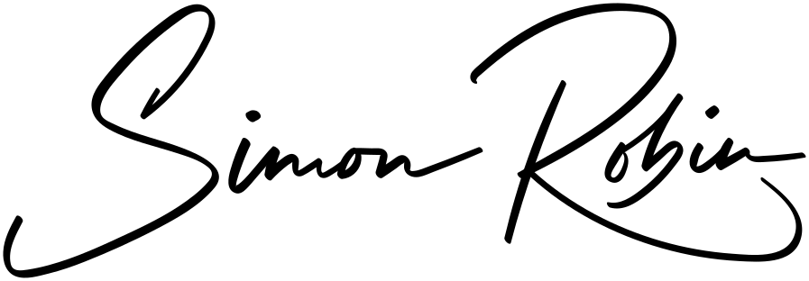</a>

<h1 align="center">sljrobin.org</h1>

Welcome to my little corner of the Internet!

This repository holds the built pages of my website, [sljrobin.org](https://sljrobin.org), served by
[GitHub Pages](https://pages.github.com/).

- The [`docs`](docs) folder contains the files a visitor's browser receives
- The [`readme`](readme) folder contains the pictures shown below

## Under the Hood

[sljrobin.org](https://sljrobin.org) is a static site, built with [Jekyll](https://jekyllrb.com/), with no plugins and no theme. Nothing is loaded from
another site, such as fonts or scripts from a [CDN](https://developer.mozilla.org/en-US/docs/Glossary/CDN), and there
are no [trackers](https://en.wikipedia.org/wiki/Web_tracking) either.

### Beyond Jekyll

The website relies on four small open-source libraries, each with one job:

- [modern-normalize](https://github.com/sindresorhus/modern-normalize), so every browser starts from the same defaults
- [PhotoSwipe](https://photoswipe.com/), to open the photographs of the [Photography](https://sljrobin.org/photography/)
  section in a [lightbox](https://en.wikipedia.org/wiki/Lightbox_%28JavaScript%29)
- [Pagefind](https://pagefind.app/), to search the [Blog](https://sljrobin.org/blog/) as you type
- [KaTeX](https://katex.org/), to set the maths when the site is built

<picture>
  <source media="(prefers-color-scheme: dark)" srcset="readme/normalize-dark.svg">
  
</picture>

<picture>
  <source media="(prefers-color-scheme: dark)" srcset="readme/features-dark.webp">
  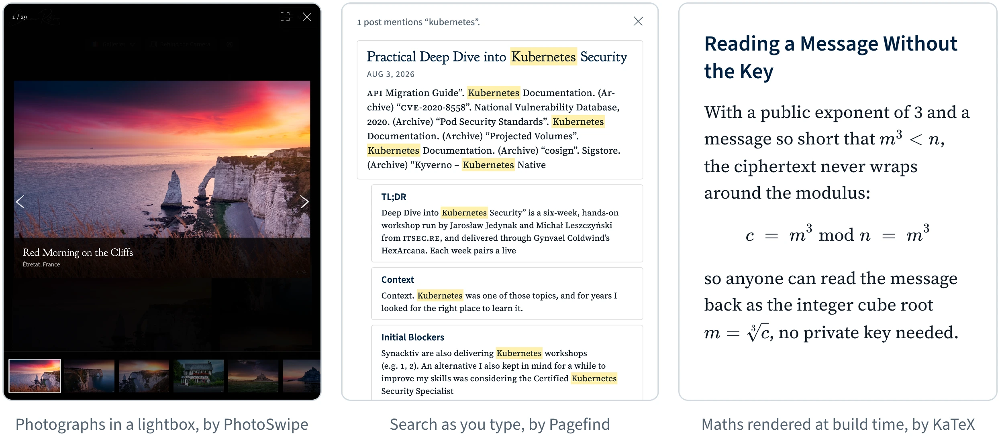
</picture>

### Before It Goes Live

I use a [Rakefile](https://ruby.github.io/rake/doc/rakefile_rdoc.html) with a few [tasks](https://ruby.github.io/rake/doc/rakefile_rdoc.html#tasks), as I find it useful to automate
the repetitive ones. The one that puts the website live is `rake deploy`. It builds the site and checks it, and a single
fault stops it before anything goes live. It works as follows.

<picture>
  <source media="(prefers-color-scheme: dark)" srcset="readme/deploy-dark.svg">
  
</picture>

In more detail, the checks are:

- Follow every link, whether it leads to another page of the site or to another website, and confirm it still works.
  The same goes for the links that jump to a section of a page, and for every image
- Validate the HTML with the [W3C](https://www.w3.org/)'s [Nu HTML Checker](https://validator.w3.org/nu/)
- Proofread the writing, including curly apostrophes (“*it’s*”, not “*it's*”), American spelling (“*color*”, not
  “*colour*”), and the [serial comma](https://en.wikipedia.org/wiki/Serial_comma)
- Measure the typography in [Chrome](https://www.google.com/chrome/) and [Firefox](https://www.mozilla.org/firefox/)
  at four widths, including line lengths, leading, sizes, and lone last words
- Load the whole site with JavaScript turned off, at four widths, as
  [progressive enhancement](https://developer.mozilla.org/en-US/docs/Glossary/Progressive_Enhancement) asks
- Enforce a [Content Security Policy (CSP)](https://developer.mozilla.org/en-US/docs/Web/HTTP/Guides/CSP) on every
  page, allowing the inline scripts by their hash alone
- Show me the [link previews](https://ogp.me/) and the [search results](https://en.wikipedia.org/wiki/Search_engine_results_page), so I read them before they go live

## Focused on Content

As an avid reader who enjoys long blog posts, I wanted to give visitors a pleasant reading experience on my [blog](https://sljrobin.org/blog/). The first step was to lay out every page for its screen, from a wide monitor to a phone.

<picture>
  <source media="(prefers-color-scheme: dark)" srcset="readme/responsive-dark.webp">
  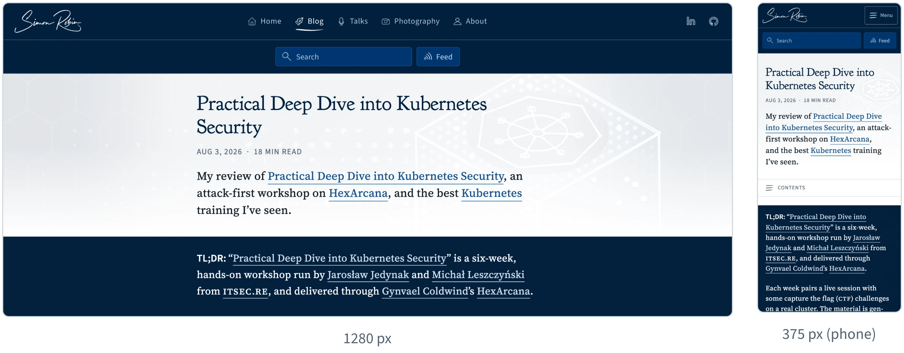
</picture>

The blog posts follow the same approach, with a table of contents that follows the reader and marks the section being
read. On smaller screens, it becomes a bar at the top.

In addition, as I try to [source](https://en.wikipedia.org/wiki/Citation) as much as I can, each reference is a numbered note that opens under its paragraph, with a link to an
archived copy (e.g., on [Archive.is](https://archive.is/) or the [Wayback Machine](https://web.archive.org/)). That way, a
reference still works even when the page it cites has gone.

<picture>
  <source media="(prefers-color-scheme: dark)" srcset="readme/blog-dark.webp">
  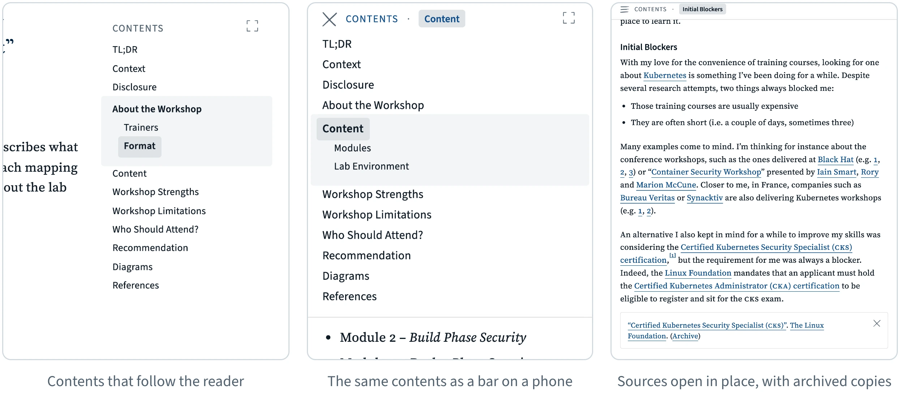
</picture>

## Design

Building websites isn't my day job, and this one taught me how much care good design takes. Each choice was a balance
between what looks right and what [web best practices](https://web.dev/) recommend, and I enjoyed finding it.

### Colors

I've always liked blue, so the site started from one dark navy, `#001f3f`. The other colors came from the combinations
of [Sanzo Wada](https://en.wikipedia.org/wiki/Sanzo_Wada), the Japanese artist behind
[*A Dictionary of Color Combinations*](https://www.goodreads.com/book/show/140534069-a-dictionary-of-color-combinations), which I browsed on [sanzo-wada.dmbk.io](https://sanzo-wada.dmbk.io/). Every text color meets the [contrast ratios](https://www.w3.org/WAI/WCAG22/Understanding/contrast-minimum.html) the
accessibility guidelines ask for, in both themes.

<picture>
  <source media="(prefers-color-scheme: dark)" srcset="readme/palette-dark.svg">
  
</picture>

### Typography

Since day one, I've been a fan of [serif fonts](https://fonts.google.com/knowledge/glossary/serif), and above all of
[Goudy Bookletter 1911](https://www.theleagueofmoveabletype.com/goudy-bookletter-1911), which sets every title. The rest
comes from [Adobe](https://www.adobe.com/)'s [Source](https://github.com/adobe-fonts) family, whose serif, [sans](https://fonts.google.com/knowledge/glossary/sans_serif), and code faces were designed to
work together. All four are served from the site itself, trimmed to what it uses, so pages stay light.

<picture>
  <source media="(prefers-color-scheme: dark)" srcset="readme/fonts-dark.svg">
  
</picture>

### Icons

Icons play a key part in any website today. I used [Font Awesome](https://fontawesome.com/) for years and wanted a
change, which led me to the [Doodle Icons](https://khushmeen.com/icons.html) by [Khushmeen](https://khushmeen.com),
drawn by hand with a fine pen.

<picture>
  <source media="(prefers-color-scheme: dark)" srcset="readme/icons-dark.svg">
  
</picture>

When the set had no icon for something, such as the [GitHub mark](https://brand.github.com/foundations/logo), I took
the [Font Awesome Free](https://fontawesome.com/search?ic=free) one and redrew it with [Rough.js](https://roughjs.com/),
a small JavaScript library that draws shapes in a sketchy, hand-drawn style.

<picture>
  <source media="(prefers-color-scheme: dark)" srcset="readme/marks-dark.svg">
  
</picture>

<blockquote>
Doodle Icons are released under <a href="https://creativecommons.org/publicdomain/zero/1.0/">CC0</a>, and
Font Awesome Free under <a href="https://creativecommons.org/licenses/by/4.0/">CC BY 4.0</a>.
</blockquote>

## A Few Surprises

This website has always been a side project I enjoy, so I let myself hide a few small surprises across it.

### Maps

The first thing I wanted in the galleries of my photographs was maps. Each one is drawn from three sets of open data:

- [mapsicon](https://github.com/djaiss/mapsicon), for the outline of each country
- [HydroRIVERS](https://www.hydrosheds.org/products/hydrorivers), for its rivers
- [Natural Earth](https://www.naturalearthdata.com/), for the neighboring countries on the [Photography](https://sljrobin.org/photography/) page's world map

Each map is drawn in three steps, shown here on [Spain](https://sljrobin.org/photography/gallery/spain/)'s.

<picture>
  <source media="(prefers-color-scheme: dark)" srcset="readme/map-steps-dark.webp">
  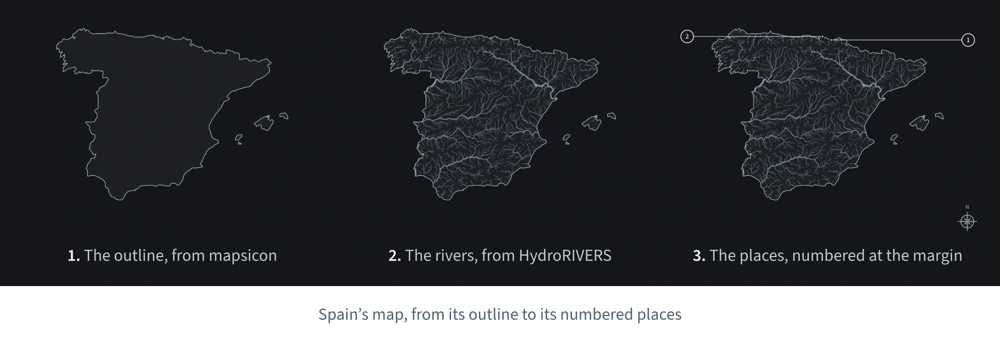
</picture>

As a couple of examples, here are the maps of the galleries from [France](https://sljrobin.org/photography/gallery/france/)
and the [UK](https://sljrobin.org/photography/gallery/uk/).

<picture>
  <source media="(prefers-color-scheme: dark)" srcset="readme/maps-dark.webp">
  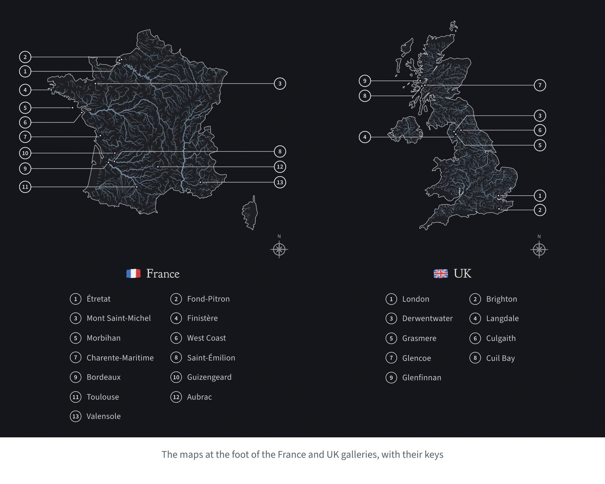
</picture>

<blockquote>
<a href="https://github.com/djaiss/mapsicon">mapsicon</a> is free to use with credit to its author,
<a href="https://github.com/djaiss">Regis Freyd</a>.
<a href="https://www.hydrosheds.org/products/hydrorivers">HydroRIVERS</a> is © the
<a href="https://www.hydrosheds.org/">HydroSHEDS</a> team (<a href="https://doi.org/10.1002/hyp.9740">Lehner and Grill, 2013</a>), used under its free license with
attribution. <a href="https://www.naturalearthdata.com/">Natural Earth</a> is in the public domain.
</blockquote>

### Hidden Gems

I also added a few animations that run across the whole website. Some of them help the reader, others are there just
for fun.

<picture><source media="(prefers-color-scheme: dark)" srcset="readme/gem-signature-dark.webp">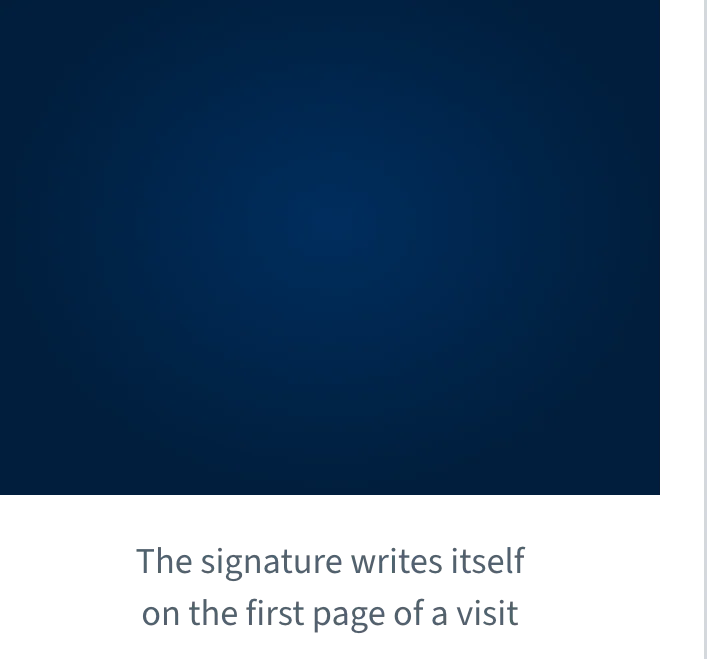</picture><picture><source media="(prefers-color-scheme: dark)" srcset="readme/gem-back-to-top-dark.webp">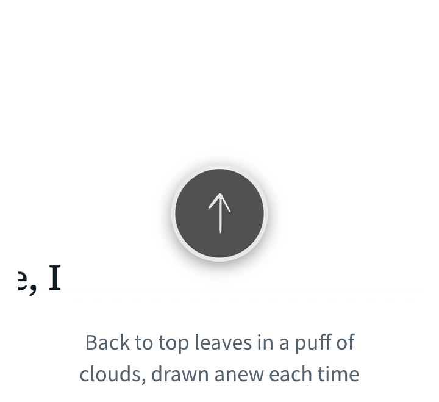</picture><picture><source media="(prefers-color-scheme: dark)" srcset="readme/gem-theme-dark.webp">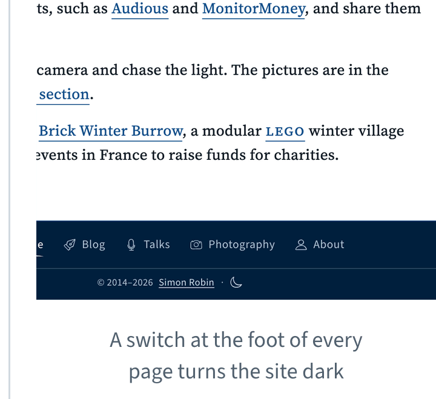</picture>

In discreet corners of the website, such as [About](https://sljrobin.org/about/) and
[Photography](https://sljrobin.org/photography/), I also took pleasure in adding a few small animations. Here are three
of them: the [checkra1n](https://checkra.in/) rook, the [AC/DC](https://www.acdc.com/) logo, and the
balloon that carries my [Instagram](https://www.instagram.com/sljrobin/).

<picture><source media="(prefers-color-scheme: dark)" srcset="readme/obj-checkra1n-dark.svg">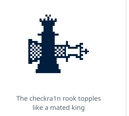</picture><picture><source media="(prefers-color-scheme: dark)" srcset="readme/obj-acdc-dark.svg"></picture><a href="https://www.instagram.com/sljrobin/"><picture><source media="(prefers-color-scheme: dark)" srcset="readme/obj-balloon-dark.svg"></picture></a>

## Credits and Copyright

A few parts of this website are other people's work, and some of mine are free to share on request.

### Illustrations

The drawings on [Talks](https://sljrobin.org/talks/) are by the talented
[Annie Ruygt](https://annieruygtillustration.com).

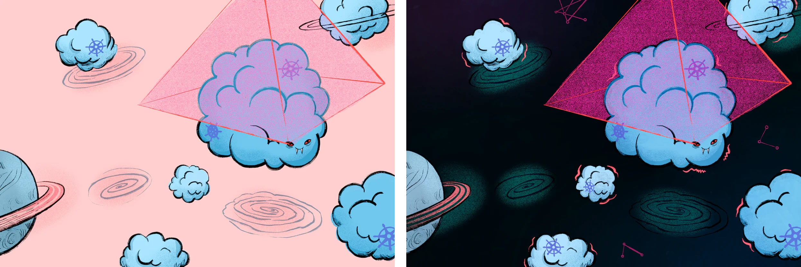

### Photographs

I'm always happy to share my pictures, especially in high resolution. Feel free to write to me on
[LinkedIn](https://www.linkedin.com/in/sljrobin), and I'll do my best to answer quickly. The photographs and the writing
are © Simon Robin, all rights reserved.

<picture>
  <source media="(prefers-color-scheme: dark)" srcset="readme/photographs-dark.jpg">
  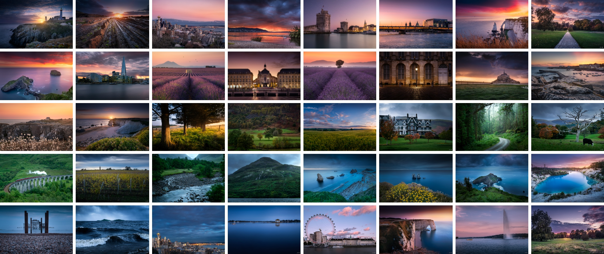
</picture>
